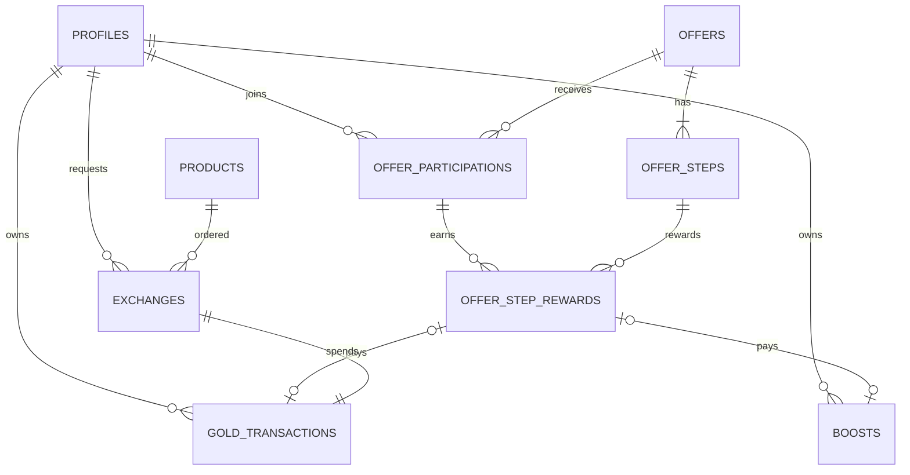

# API·DB 설계

오퍼월(오퍼 리스트 → 상세 → 참여 → 지급)을 중심으로, 앱이 서버와 어떻게 대화하고 서버가 데이터를 어떻게 저장하는지 정리한 문서.
실제 스키마는 [supabase/migrations/20261031000000_init.sql](../supabase/migrations/20261031000000_init.sql)에 있다.

- 서버: **Supabase** (PostgreSQL + 자동 REST API + 인증)
- 사용자: 기기마다 **익명 로그인**. 회원가입 없이 기기별로 내 기록이 분리된다

## 1. 요구사항

### 오퍼 (핵심)
| ID | 요구사항 |
|---|---|
| OF-1 | 오퍼 리스트 페이지: 진행 중인 캠페인 목록, 종류(앱 설치·회원가입·게임 등), 총 보상, 내 참여 상태 |
| OF-2 | 오퍼 상세: 단계별 보상과 단계 상태(참여 가능 / 지급 대기 / 지급 완료), 참여 기한 |
| OF-3 | 참여: 같은 오퍼에는 한 번만 참여. 참여하면 기한이 시작된다 |
| OF-4 | 단계 완료: 참여 중이고, 기한 안이고, 앞 단계를 끝냈을 때만. 완료하면 **지급 대기** |
| OF-5 | 지연 지급: 완료 3초 뒤 **지급 완료** → 금 내역과 속도 보상이 생기고 잔액이 늘어난다 |
| OF-6 | 중복 방지: 같은 단계를 연타하거나 다시 요청해도 보상은 한 번 |

### 지갑·교환
| ID | 요구사항 |
|---|---|
| WL-1 | 잔액 = 금 내역의 합 (잔액은 저장하지 않는다) |
| WL-2 | 금 줍기: 채굴량을 적립. 한 번에 채굴 상한을 넘을 수 없다 |
| EX-1 | 교환: 가격은 서버의 상품 표에서 읽고, 잔액이 부족하면 거절. 동시에 여러 번 눌러도 잔액이 음수가 되지 않는다 |

### 앱 쪽 연동
| ID | 요구사항 |
|---|---|
| API-1 | 서버 호출은 `src/api/`에서만. 화면은 `api.joinOffer()` 같은 함수만 부른다 |
| API-2 | 실패는 `ApiError(code, message)` 하나로 통일. 화면은 message를 그대로 보여 준다 |
| API-3 | 화면마다 로딩 / 에러(다시 시도) / 빈 목록 상태 |
| API-4 | 돈이 걸린 요청(금 줍기, 교환, 단계 완료)은 **중복 방지 key(멱등성 키)**를 함께 보낸다 |
| API-5 | 지급 대기 중이면 1초마다 정산을 요청해 지급 완료로 바뀌는 걸 보여 준다 |
| API-6 | 금 줍기·교환은 **낙관적 업데이트**: 잔액을 먼저 바꾸고, 서버가 실패하면 되돌린다 |

## 2. REST API

### 2-1. 설계한 API
주소는 명사(자원), 행동은 HTTP 메서드로 나타낸다. 예를 들어 "단계를 완료한다"는 동사 주소(`/completeStep`) 대신 "완료 기록을 만든다"(`POST .../completions`)로 쓴다.

| 메서드 | 주소 | 하는 일 | 성공 | 대표 실패 |
|---|---|---|---|---|
| GET | `/offers` | 오퍼 목록 + 단계 | 200 | |
| GET | `/me/offer-participations` | 내 참여 | 200 | |
| GET | `/me/offer-rewards` | 내 단계 보상 | 200 | |
| POST | `/offers/{offerId}/participations` | 참여 | 201 (이미 참여면 200) | 404 OFFER_NOT_FOUND |
| POST | `/offers/{offerId}/steps/{stepId}/completions` | 단계 완료 → 지급 대기 | 201 | 409 NOT_PARTICIPATING, STEP_LOCKED, OFFER_EXPIRED |
| POST | `/me/offer-rewards/settlements` | 지급 시각이 지난 보상 지급 | 200 (방금 지급된 목록) | |
| GET | `/me/gold-transactions` | 내 금 내역 (잔액 = 합) | 200 | |
| POST | `/me/gold-transactions` | 금 적립 (금 줍기) | 201 | 422 INVALID_AMOUNT |
| POST | `/exchanges` | 교환 신청 | 201 | 409 INSUFFICIENT_BALANCE |
| GET | `/me/boosts` | 내 속도 보상 | 200 | |
| POST | `/me/boosts` | 속도 보상 (출석, 룰렛) | 201 | 422 INVALID_AMOUNT |

공통 규칙
- 돈이 걸린 POST는 `Idempotency-Key` 헤더를 보낸다. 같은 key가 다시 오면 새로 만들지 않고 처음 결과를 돌려준다
- 실패 응답: `{ "error": { "code": "INSUFFICIENT_BALANCE", "message": "보유하신 금이 부족합니다" } }`
- 금액은 정수(10⁻¹²g 단위)

예시
```http
POST /offers/stock-signup/steps/6/completions
Idempotency-Key: offer:stock-signup:6
```
```json
201 Created
{ "data": { "stepId": 6, "status": "pending", "payAt": "2026-10-31T10:00:03Z",
            "reward": { "gold": 100000000, "boostPercent": 100 } } }
```

### 2-2. Supabase로 구현한 모습
Supabase는 테이블마다 조회 API(PostgREST)를 자동으로 만들고, 규칙이 필요한 쓰기는 DB 함수(RPC)로 노출한다. 위 설계를 이렇게 옮겼다.

| 설계한 API | 실제 호출 | 앱 함수 (`src/api/`) |
|---|---|---|
| `GET /offers` | `GET /rest/v1/offers?select=*,offer_steps(*)&status=eq.active` | `offers.listOffers` |
| `GET /me/offer-participations` | `GET /rest/v1/offer_participations` (RLS로 내 것만) | `offers.listMyParticipations` |
| `GET /me/offer-rewards` | `GET /rest/v1/offer_step_rewards` (RLS로 내 것만) | `offers.listMyStepRewards` |
| `POST /offers/{id}/participations` | `POST /rest/v1/rpc/join_offer` | `offers.joinOffer` |
| `POST .../completions` | `POST /rest/v1/rpc/complete_offer_step` | `offers.completeStep` |
| `POST /me/offer-rewards/settlements` | `POST /rest/v1/rpc/settle_my_offer_rewards` | `offers.settleRewards` |
| `GET /me/gold-transactions` | `GET /rest/v1/gold_transactions` | `wallet.listGoldTransactions` |
| `POST /me/gold-transactions` | `POST /rest/v1/rpc/earn_gold` | `wallet.earnGold` |
| `POST /exchanges` | `POST /rest/v1/rpc/exchange_product` | `wallet.exchangeProduct` |
| `GET /me/boosts` | `GET /rest/v1/boosts` | `boosts.listBoosts` |
| `POST /me/boosts` | `POST /rest/v1/rpc/add_boost` | `boosts.addBoost` |

- 멱등성 키는 헤더 대신 함수 인자(`p_key`)로 보내고, DB의 `unique (user_id, idempotency_key)` 제약이 지킨다
- 에러는 DB 함수가 `message`에 코드, `detail`에 안내 문장을 담고, `src/api/client.ts`의 `toApiError`가 `ApiError`로 바꾼다
- 나중에 직접 만든 서버로 옮겨도 `src/api/` 안쪽만 바꾸면 되고, 화면과 Provider는 그대로다

## 3. DB

### 3-1. ERD


### 3-2. 테이블
| 테이블 | 역할 | 핵심 제약 |
|---|---|---|
| `profiles` | 사용자 (익명 로그인 id) | `id` = `auth.users.id` |
| `offers` | 오퍼(캠페인). 홈 미션 타일 하나 = 오퍼 하나 | `tile_id` unique |
| `offer_steps` | 단계와 단계별 보상 (금 + 속도) | `(offer_id, step_order)` unique |
| `offer_participations` | 참여 (참여 중 / 완료) | `(user_id, offer_id)` unique → 한 번만 참여 |
| `offer_step_rewards` | 단계 보상 지급 (pending → paid) | `(participation_id, step_id)` unique → 한 번만 완료 |
| `gold_transactions` | 금 내역. 잔액 = 합 | `(user_id, idempotency_key)` unique, `amount > 0` |
| `boosts` | 채굴 속도 보상 | `(user_id, idempotency_key)` unique |
| `products` | 교환 상품과 가격 | `cost_gold > 0` |
| `exchanges` | 교환 신청 | `(user_id, idempotency_key)` unique |

설계 결정
- **잔액 칸이 없다.** `profiles`에 balance가 없고, 잔액은 `gold_transactions`의 합이다. 내역과 잔액이 어긋날 수 없다
- **금은 `bigint`.** 1 = 10⁻¹²g. 소수 계산 오차가 없다
- **보상 값 복사.** `offer_step_rewards`에 완료 순간의 보상을 복사해 둔다. 나중에 오퍼 보상이 바뀌어도 이미 약속한 보상은 그대로다
- **기한 만료는 저장하지 않는다.** `expires_at`과 지금 시각으로 계산한다
- **출처 추적.** 금 내역과 속도 보상은 어느 단계 보상(`offer_step_reward_id`)이나 교환(`exchange_id`)에서 생겼는지 가리킨다
- 채굴 시작 시각은 기기에 둔다. 채굴량은 시작 시각과 속도 보상으로 계산하는 값이고, 서버는 적립할 때 상한만 검사한다

### 3-3. 오퍼 상태 변화
```
(참여 전) ──join_offer──▶ offer_participations: joined
   단계 완료 ──complete_offer_step──▶ offer_step_rewards: pending (pay_at = 지금 + 3초)
   pay_at 지남 ──settle_my_offer_rewards──▶ paid
                 + gold_transactions 한 줄 (잔액 증가)
                 + boosts 한 줄 (속도 증가)
   모든 단계 paid ──▶ offer_participations: completed
```
지급은 따로 타이머 서버를 두지 않고, 앱이 정산을 요청할 때 처리한다. 앱을 껐다 켜도 `pay_at`이 서버에 남아 있어서 다음 요청 때 지급된다.

## 4. 데이터 보호
앱에 들어가는 Supabase 키는 공개 키라서, 누가 무엇을 할 수 있는지는 DB가 직접 지킨다.

- **RLS(행 단위 보안)**: 모든 테이블에 켜져 있다. 오퍼·단계·상품은 누구나 조회, 나머지는 `user_id = 내 id`인 행만 조회
- **쓰기 정책 없음**: 앱은 테이블에 직접 쓸 수 없다. 모든 쓰기는 DB 함수(`security definer`)로만 하고, 함수 안에서 규칙을 검사한다
- **트랜잭션과 잠금**: 지급(보상 상태 + 금 내역 + 속도)은 한 함수 안에서 함께 처리된다. 교환·정산은 사용자 행을 잠가(`for update`) 동시 요청을 한 줄로 세운다

검증 (로컬 Supabase에서 실행)
- 참여 전 단계 완료 → `NOT_PARTICIPATING`, 앞 단계 건너뛰기 → `STEP_LOCKED`
- 같은 단계·같은 교환·같은 금 줍기 key 재요청 → 처음 기록을 그대로 반환
- 상한을 넘는 금 줍기 → `INVALID_AMOUNT`, 출처 위조(`offer`로 적립) → `INVALID_SOURCE`
- 테이블 직접 쓰기 → RLS로 거절, 내부 함수 호출 → 권한 없음
- 잔액이 상품 1개만큼일 때 교환 5번 동시 요청 → 1번만 성공, 잔액은 음수가 되지 않음
- 다른 사용자는 내 내역을 볼 수 없음

## 5. 알려진 한계
- 채굴량은 기기에서 계산해서 보낸다. 서버는 한 번에 상한(0.000120g)을 넘는지만 검사한다
- 개발자 모드(금 추가, 초기화)도 같은 API를 쓰므로, 시연이 끝나면 서버 함수에서 `dev` 출처를 막아야 한다
- 오퍼 단계 완료는 실제 광고주 확인 대신 버튼으로 처리한다 (mock)
- 교환 상품 화면은 앱의 상품 데이터로 그리고, 가격 검사와 차감은 서버의 `products` 표로 한다. 두 곳의 id와 가격을 같게 맞춰 두었다
