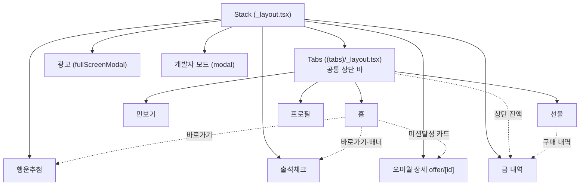
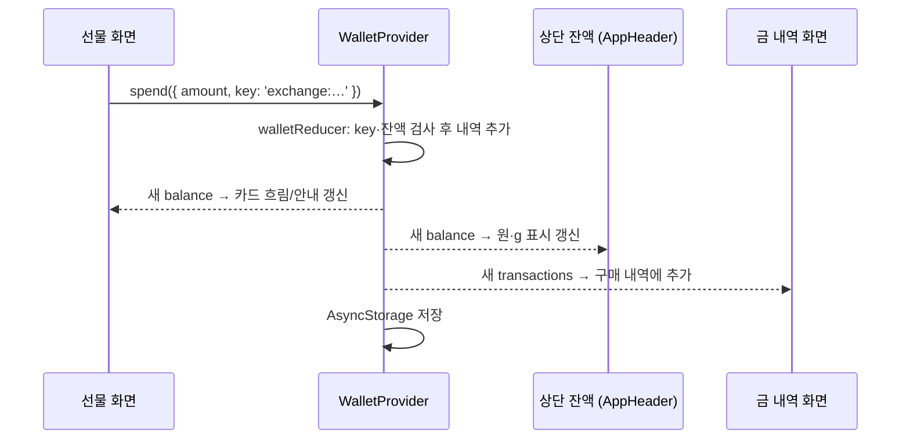

# 설계 문서

금줍줍 모작의 폴더 구조, 상태 관리 방식, 더미 데이터 구조.
실제 앱을 분석한 내용은 [analysis.md](analysis.md), 서버 API와 DB 설계는 [api-db.md](api-db.md)에 있다.

> **10/31 변경:** 지갑·속도 보상·오퍼월을 기기 저장(AsyncStorage)에서 **Supabase 서버**로 옮겼다.
> 화면 → Provider → `src/api/` → Supabase(DB) 순서로 데이터가 흐르고, 진짜 기록은 서버에 있다.
> 아래 2-6(저장)과 3(더미 데이터)은 서버 연동 전 구조를 함께 남겨 둔 것이다.

## 1. 폴더 구조

```
src/
├── app/                      화면 주소(라우팅)만. 파일 하나 = 화면 하나 (Expo Router)
│   ├── _layout.tsx           Provider 3개 + Stack (모든 화면의 뿌리)
│   ├── (tabs)/
│   │   ├── _layout.tsx       하단 탭 4개 + 공통 상단 바(AppHeader)
│   │   ├── (home)/index.tsx  홈
│   │   ├── pedometer.tsx     만보기 (준비 중)
│   │   ├── exchange.tsx      선물
│   │   └── settings.tsx      프로필
│   ├── roulette.tsx          행운추첨(룰렛)
│   ├── attendance.tsx        출석체크
│   ├── history.tsx           금 내역
│   ├── offer/[id].tsx        오퍼월 미션 상세 (id가 주소에 들어감)
│   ├── ad.tsx                mock 광고 (전체 화면)
│   └── dev.tsx               개발자 모드
├── features/                 기능별 로직과 UI
│   ├── wallet/               지갑: 내역·잔액 (types, gold, store, WalletProvider)
│   ├── mining/               채굴: 채굴량 계산·속도 보상 (mining, MiningProvider, useMining, MiningCard)
│   ├── offer/                오퍼월: 참여·지급 대기 (OfferProvider, OfferScreen)
│   ├── ads/                  mock 광고 (watchAd, AdScreen)
│   ├── attendance/           출석
│   ├── roulette/             룰렛
│   ├── exchange/             선물(교환)
│   ├── history/              금 내역
│   ├── home/                 홈 구성 요소 (배너, 미션 판, 바로가기)
│   ├── layout/               상단 바, 잔액 표시, 색상(theme)
│   ├── reward/               보상 팝업 (여러 기능이 같이 씀)
│   ├── dev/                  개발자 모드
│   └── pedometer/, settings/ 준비 중 화면
├── data/                     더미 데이터 (서버 대신)
└── utils/date.ts             날짜 key·표시 형식
```

### 나눈 기준
- **`app/`에는 화면 주소만 둔다.** `_layout.tsx`를 빼면 모두 `export { default } from '@/features/…'` 한 줄이다.
  화면 내용은 `features/`에 있어서, 주소 구조를 바꿔도 기능 코드는 그대로다.
- **`features/`는 기능 단위로 묶는다.** 한 기능의 계산(순수 함수), 상태(Provider), 화면(컴포넌트)이 한 폴더에 있다.
  예: `mining/mining.ts`(계산) → `MiningProvider.tsx`(상태) → `MiningCard.tsx`(화면)
- **계산은 React와 분리한다.** `store.ts`, `mining.ts`, `roulette.ts`는 React를 import하지 않는 순수 함수라서 입력만 보고 결과를 확인할 수 있다.
- **`data/`는 서버가 줄 데이터를 대신한다.** 서버가 생기면 이 파일들 대신 API 응답을 쓰면 된다.

### 화면 지도

- 탭 화면 위에 Stack 화면이 **쌓이는** 구조다. 행운추첨에서 뒤로 가면 홈(탭)이 그대로 남아 있다.
- 광고는 `fullScreenModal`에 뒤로 가기 제스처를 꺼서, 끝까지 보거나 닫기를 눌러야만 나갈 수 있다.

## 2. 상태 관리 방식

### 2-1. 상태가 사는 세 곳
| 어디 | 무엇 | 예시 |
|---|---|---|
| `useState` (화면 안) | 그 화면에서만 쓰고 나가면 사라져도 되는 값 | 팝업 열림 여부, 선택한 탭, 룰렛 회전 중 |
| Context Provider (앱 전체) | 여러 화면이 같이 봐야 하는 값 | 지갑 내역, 채굴 상태, 오퍼월 진행 |
| Supabase (서버) | 사용자별로 남아야 하는 기록 | 금 내역, 속도 보상, 오퍼 참여·지급, 교환 |
| AsyncStorage (기기) | 이 기기에서만 의미 있는 값 | 채굴 시작 시각, 로그인 세션 |

전역 상태 라이브러리(Redux, Zustand 등)는 쓰지 않았다. 전역 상태가 3개뿐이고 각각 독립적이라 React 기본 기능(Context + useReducer/useState)으로 충분했다.

### 2-2. Provider 3개와 순서
```tsx
<WalletProvider>        {/* 지갑: 금 내역 → 잔액 */}
  <MiningProvider>      {/* 채굴: 시작 시각 + 속도 보상 내역 */}
    <OfferProvider>     {/* 오퍼월: 참여·지급 대기 */}
      <Stack>…</Stack>
```
- `OfferProvider`는 보상이 지급되면 지갑(`refresh`)과 속도 보상(`refreshBoosts`)을 다시 받아 오므로 **두 Provider 안에** 있어야 한다.
- 지갑과 채굴은 서로를 모른다. 두 Provider를 함께 쓰는 곳은 화면(`MiningCard`)이다.
  금 줍기 = `collect()`로 채굴량을 꺼냄 → `earn()`으로 지갑에 적립.

### 2-3. 잔액 = 내역의 합
과제 원칙 "포인트 잔액은 항상 내역의 합과 일치"를 **잔액을 저장하지 않는 방식**으로 지킨다.

```ts
// src/features/wallet/store.ts
type WalletState = { transactions: Transaction[] }; // balance 필드가 없다

function getBalance(transactions) {
  return transactions.reduce((sum, tx) => (tx.type === 'earn' ? sum + tx.amount : sum - tx.amount), 0);
}
```
- 잔액과 내역을 따로 저장하면, 한쪽만 바뀌는 버그가 생길 때 둘이 어긋난다. 내역만 저장하고 잔액은 매번 계산하면 **어긋날 수가 없다.**
- 금을 바꾸는 길은 `walletReducer`의 `earn` / `spend` 두 가지뿐이다. 여기서 한 번에 검사한다.
  - 금액이 0 이하 → 무시
  - 같은 `key`의 내역이 이미 있음 → 무시 (중복 적립 방지)
  - `spend`인데 잔액보다 많음 → 무시 (잔액이 음수가 되지 않음)
- 개발자 모드도 잔액을 직접 바꾸지 않고 "개발자 모드 지급/차감" **내역을 추가**한다.

### 2-4. 중복 적립 방지 (key)
모든 보상과 차감에는 "이 보상이 무엇인지"를 나타내는 `key`가 붙고, 같은 key는 한 번만 기록된다.

| 보상 | key | 막아 주는 상황 |
|---|---|---|
| 출석 | `attendance:2026-10-29` | 같은 날 두 번 출석 |
| 룰렛 | `roulette:2026-10-29:1` ~ `:3` | 하루 3회 초과, 같은 회차 두 번 기록 |
| 금 줍기 | `mining:<채굴 시작 시각>` | 같은 채굴분을 두 번 적립 |
| 오퍼월 | `offer:nyang-escape:lv5` | 같은 단계 보상 두 번 지급 |
| 교환 | `exchange:<상품 id>:<시각>` | [교환하기] 연타. key는 확인 팝업이 열릴 때 한 번 만든다 |
| 개발자 모드 | `dev:<시각>:<난수>` | (매번 새 key) |

- 날짜 key는 `toISOString()`(UTC)이 아니라 **기기 시간 기준** `toLocalDateKey()`로 만든다. UTC를 쓰면 한국 시간 오전 0~9시에 날짜가 하루 밀린다.
- 버튼 연타는 key와 함께 화면 쪽에서도 막는다. 예: `watchAd`는 광고가 이미 떠 있으면 무시한다.

### 2-5. 저장하지 않고 계산하는 값
| 값 | 저장하는 것 | 계산 |
|---|---|---|
| 잔액 | 금 내역 | `getBalance(transactions)` |
| 채굴량 | 채굴 시작 시각, 속도 보상 내역 | `getMinedAmount(startedAt, now, boosts)` |
| 채굴 속도 | 속도 보상 내역 | `getSpeedPercent(boosts, now)` = 100% + 켜져 있는 보상 합 |
| 출석·룰렛 오늘 횟수 | 속도 보상 내역 | 오늘 날짜 key가 몇 개인지 |
| 오퍼월 단계 상태 | 지급 예정 시각 | 보상 key 있음 → 지급 완료, 예정 시각 있음 → 지급 대기, 없음 → 참여 가능 |

채굴량을 1초마다 더해서 저장하면 앱이 꺼져 있는 동안 멈추고 저장도 자주 해야 한다.
시작 시각만 저장하고 `(지금 − 시작 시각) × 속도`로 계산하면, 앱을 다시 켰을 때 그동안 쌓인 양이 바로 나온다.
화면은 `useMining`이 1초마다 `now`만 갱신해서 다시 계산한다.

### 2-6. 저장 (서버 연동 전: AsyncStorage)
서버 연동 후에는 지갑·속도 보상·오퍼가 Supabase에 저장되고, Provider는 앱 시작 때 `src/api/`로 불러온다. 금 줍기와 교환은 화면에 먼저 반영하고 서버가 실패하면 되돌린다(낙관적 업데이트). 자세한 흐름은 [api-db.md](api-db.md).
| 저장 키 | Provider | 내용 |
|---|---|---|
| `wallet:state` | WalletProvider | `{ transactions }` |
| `mining:state` | MiningProvider | `{ startedAt, boosts }` |
| `offer:state` | OfferProvider | `{ joined, pending }` |

```ts
// 앱이 켜지면 한 번 불러오고 (처음이면 샘플 내역으로 시작)
useEffect(() => { load(); setIsLoaded(true); }, []);
// 불러오기가 끝난 뒤부터, 바뀔 때마다 저장
useEffect(() => {
  if (!isLoaded) return;
  AsyncStorage.setItem(STORAGE_KEY, JSON.stringify(state));
}, [state, isLoaded]);
```
- `isLoaded`가 없으면, 불러오기가 끝나기 전의 빈 상태가 먼저 저장돼서 **저장된 데이터를 덮어쓴다.**
- 저장된 값이 깨져 있으면(JSON 파싱 실패) 무시하고 새로 시작한다.

### 2-7. 화면 간 동기화
모든 화면이 같은 Provider 값을 읽기 때문에, 어디서 바꿔도 다른 화면이 같이 다시 그려진다.



### 2-8. mock 광고 연결
`watchAd(onComplete)`가 "광고를 끝까지 보면 할 일"을 맡겨 두고 `/ad` 화면을 띄운다.
광고 화면은 타이머가 끝난 뒤 닫기를 누르면 `completeAd()`로 그 일을 실행한다.
출석, 룰렛 추가 회차, 금 줍기가 모두 이 함수를 쓴다.
광고 SDK를 붙일 때는 `watchAd` 안쪽만 바꾸면 된다.

## 3. 더미 데이터 구조

모두 `src/data/`에 있는 TypeScript 파일이다. 서버 대신 앱에 같이 들어간다.

| 파일 | 무엇 | 주요 값 |
|---|---|---|
| `user.ts` | 사용자 | `{ id: 'user-1', nickname: '줍줍이' }` |
| `initialTransactions.ts` | 처음 설치했을 때 금 내역 | 3건, 합계 0.010130g (약 1,580원) |
| `products.ts` | 교환 상품 | 골드바 1·2·3·5g, 카카오 상품권 1만·2만·3만원 |
| `offers.ts` | 오퍼월 미션 | 냥탈출: 5단계 (5·10·15·20·25레벨), 속도 +75 ~ +300% |
| `missionTiles.ts` | 홈 미션 타일 | 드릴·폭발·마법구슬 등 7개 (누르면 준비 중) |
| `rewards.ts` | 보상 규칙 | 출석 +10%, 룰렛 하루 3회(첫 회 무료), 꽝 3칸·랜덤 3칸, 랜덤 +5/10/15/20% |

### 금 단위
- 금은 **1 = 10⁻¹²g인 정수**(`GoldUnits`)로 저장한다. 실제 앱이 소수점 12자리까지 보여 주기 때문이다.
- 소수(0.1 + 0.2 ≠ 0.3)로 더하고 빼면 오차가 쌓여서 "잔액 = 내역의 합"이 깨질 수 있다. 정수는 정확하다.
- 원화 환산은 모의 시세 `1g = 156,000원`(`KRW_PER_GRAM`)으로 한다.
  - 표시용 원화(`unitsToKrw`)는 내림: 가진 금보다 많아 보이지 않게
  - 상품 가격의 금 환산(`krwToUnits`)은 올림: 원화 가격보다 싸게 교환되지 않게

### 금 내역 (Transaction)
```ts
type Transaction = {
  id: string;
  type: 'earn' | 'spend';     // 적립 / 차감
  amount: GoldUnits;           // 항상 양수. 방향은 type으로
  title: string;               // 내역에 보이는 이름. 예: '금 줍기'
  source: 'attendance' | 'mining' | 'message' | 'exchange' | 'dev'; // 어디서 생겼는지 (아이콘)
  key: string;                 // 중복 방지 key
  createdAt: string;           // ISO 시각
};
```

### 속도 보상 (Boost)
```ts
type Boost = {
  id: string;
  title: string;            // 예: '출석 체크'
  percent: number;          // 예: 10 → +10%. 룰렛 꽝은 0 (참여 기록용)
  key: string;              // 중복 방지 key
  activatedAt: string;      // 받은 시각
  expiresAt: string | null; // 끝나는 시각. null이면 영구
};
```
금 내역과 따로 두는 이유: 출석·룰렛·오퍼월 보상은 금이 아니라 속도라서, 지갑 내역에 넣으면 "잔액 = 내역의 합"이 흐려진다.

### 상품 (Product)
```ts
type Product = {
  id: string;            // 'gold-1g', 'kakao-10000'
  category: 'gold' | 'gifticon';
  group: string;         // 브랜드 묶음. '삼성금거래소', 'Kakao'
  name: string;          // 카드 큰 글자. '1 g', '10,000원'
  fullName: string;      // 확인 팝업·내역 이름
  priceKrw: number;      // 원화 가치
  cost: GoldUnits;       // 필요한 금
  badgePercent: number;  // 카드 배지 (뜻을 확인하지 못해 모양만 표시)
  emoji: string; visual: string; color: string; // 상품 이미지 대신 (상표 이미지는 쓰지 않음)
};
```

### 오퍼월 미션 (Offer)
```ts
type Offer = {
  id: string;            // 'nyang-escape'
  category: string;      // '폭발 미션'
  title: string;         // '냥탈출'
  deadlineDays: number;  // 참여 후 기한
  multiplier?: number;   // 보상 배수
  steps: { id: string; label: string; percent: number }[];
};
```
