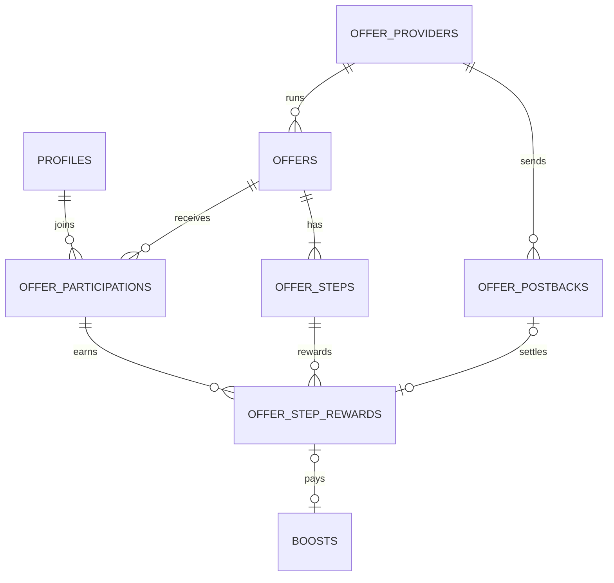

# 오퍼월 재설계안 (제안)

실제 금줍줍의 미션 타일 7개를 다시 분석해 보니, 오퍼월은 금줍줍이 직접 운영하는 목록이 아니라 **외부 오퍼월 회사 7곳의 화면**이었다.
이 문서는 그 구조에 맞춰 지금의 DB·API([api-db.md](api-db.md))를 어떻게 바꿀지 정리한 제안이다. 확인을 받은 뒤 구현한다.

## 1. 분석: 미션 타일 7개

| 타일 | 화면 구성 | 보상 표시 | 판단 |
|---|---|---|---|
| 드릴 | 영어 UI. FOR YOU / Top Offers, 탭 Home·My Offers·Rewards·Earnings | 자체 코인 (예: 62.69K) | 외부 회사 (해외 게임형) |
| 폭발 | 진행 중 / 추천(싱글·멀티) / 신규 / 전체 게임 | % | 외부 회사 (게임 특화) |
| 마법구슬 | 영어 UI. 탭 Apps·Active·Help. "지금 받을 수 있는 앱 없음" | 확인 못 함 | 외부 회사 (이 기기·지역엔 캠페인 없음) |
| 곡괭이 | 탭 간편·참여·게임·쇼핑, 필터 전체·게임·멀티·실행확인 | 자체 포인트 P | 외부 회사 (종합형) |
| 마법봉 | "리워드 충전소". 홈·전체 미션, 쇼핑 적립, HOT 미션, 이번 달 총 적립 | % | 외부 회사 (쇼핑·제휴형) |
| 광차 | 탭 간편적립·참여적립·구매적립, "소셜형" 배지. 하단 "COPYRIGHT © PINCRUX" | % | **PINCRUX** (확인됨) |
| 보따리 | "혜택받기". AI 추천 / 매일 무료 이벤트(미니게임) / 적립 많은 캠페인 / 참여자 많은 캠페인 | %, "Up to" | 외부 회사 (게임·미니게임 종합형) |

공통점
- **캠페인 종류**: 소셜(구독·팔로우·알림), 설치·실행, 가입·신청, 게임 싱글/멀티(단계별), 쇼핑
- **진행 중 목록**: "진행 중", "진행중인 캠페인", My Offers, Active
- **보상**: 회사마다 단위가 다르지만 금줍줍 화면에는 대부분 **채굴 속도 %**로 환산돼 보인다
- **중복 제한**: "처음 설치하는 게임만 적립. 이미 설치했거나 다른 곳에서 참여한 게임은 목록에 나오지 않음"

실제 흐름 (추정)
```
타일 클릭 → 그 회사의 오퍼월 화면 (금줍줍 사용자 id 전달)
사용자가 회사 화면에서 미션 수행 → 회사가 수행 여부 확인
회사 서버 → 금줍줍 서버로 보상 알림 (포스트백): 사용자, 캠페인, 회사 포인트, 회사 거래번호
금줍줍 서버 → 거래번호 중복 확인 → 회사별 환산율로 % 계산 → 채굴 속도 지급
```

## 2. 지금 설계와 달라지는 점

| | 지금 (api-db.md) | 바꾼 뒤 |
|---|---|---|
| 오퍼는 누구 것인가 | 금줍줍이 직접 운영 | **회사(provider)**의 캠페인 |
| 미션 타일 | 타일 1개 = 오퍼 1개 | 타일 1개 = **회사 1곳** (회사의 캠페인 목록이 열림) |
| 지급을 시작하는 쪽 | 앱이 1초마다 정산 요청 | **회사가 포스트백**을 보냄 (mock 회사가 대신) |
| 보상 | 금 + 채굴 속도 | **채굴 속도 %만** (실제 앱과 같게) |
| 중복 제한 | 같은 오퍼·같은 단계 | + **같은 앱은 회사가 달라도 한 번만** |

보상을 속도 %만으로 바꾸면 과제 PDF의 "지급 후 잔액 갱신"과는 다르다. 분석으로 확인한 실제 구조를 따르고, README에 이유를 적는다.

## 3. DB 변경



### 새 테이블
**`offer_providers`**: 오퍼월 회사 (타일 하나 = 회사 하나)
| 칸 | 예 | 설명 |
|---|---|---|
| `id` | `pincrux` | 회사 식별자 |
| `tile_id` | `cart` | 홈 미션 타일 |
| `name` | 광차 미션 | 화면 제목 |
| `point_unit` | `P`, `coin`, `%` | 회사 자체 단위 |
| `percent_per_point` | 0.01 | 환산율: 회사 포인트 1 → 채굴 속도 몇 % |
| `postback_secret` | (비밀) | 포스트백 서명 검증용. 앱에서는 읽을 수 없음 |

**`offer_postbacks`**: 회사에서 받은 보상 알림 원본
| 칸 | 설명 |
|---|---|
| `provider_id`, `provider_txn_id` | **둘을 합쳐 유니크** → 같은 알림이 여러 번 와도 한 번만 처리 |
| `user_id`, `offer_id`, `step_id` | 누구의 어느 단계인지 |
| `points` | 회사 단위 보상 |
| `status` | `received` → `applied` / `rejected` |
| `reject_reason` | 서명 불일치, 참여 안 함, 중복 앱 등 |
| `payload` | 받은 원문 (문제 생겼을 때 확인용) |

### 바뀌는 테이블
- `offers`: `provider_id` 추가, `tile_id`는 `offer_providers`로 이동. `app_package`(대상 앱 식별자) 추가
- `offers.campaign_type`: `social`(구독·팔로우), `install`, `signup`, `game_single`, `game_multi`, `shopping`
- `offer_step_rewards`: `reward_gold` 제거(속도만), `postback_id` 추가
- 중복 앱 제한: `offer_participations`에 `app_package`를 복사해 두고 `(user_id, app_package)` 유니크

## 4. API 변경

| 메서드 | 주소 | 누가 부르나 | 하는 일 |
|---|---|---|---|
| GET | `/offer-providers` | 앱 | 타일 7개와 회사 정보 |
| GET | `/offers?provider={id}` | 앱 | 그 회사의 캠페인 목록 |
| POST | `/offers/{offerId}/participations` | 앱 | 참여 (같은 앱을 다른 회사에서 참여했으면 `APP_ALREADY_JOINED`) |
| POST | `/offers/{offerId}/steps/{stepId}/completions` | 앱 | **mock 전용**: "미션 수행"을 흉내 내고, mock 회사에 포스트백 예약 |
| POST | `/postbacks/{providerId}` | **회사 서버** | 보상 알림. 서명 검증 → 중복 확인 → 환산 → 속도 지급 |
| GET | `/me/offer-rewards` | 앱 | 내 보상 내역 (지급 대기 / 지급 완료) |

포스트백 예시
```http
POST /postbacks/pincrux
X-Signature: sha256=…   (요청 본문을 회사 비밀값으로 서명)
```
```json
{ "txn_id": "PX-20261102-0001", "user_id": "8a7b…", "offer_id": "nyang-escape",
  "step": 3, "points": 1500 }
```
```json
200 OK  { "status": "applied", "boostPercent": 15 }
200 OK  { "status": "duplicate" }    // 같은 txn_id가 다시 와도 성공으로 응답 (회사가 재전송을 멈추게)
```

Supabase에서는 포스트백 주소를 **Edge Function**으로 만든다. 회사 서버는 금줍줍 사용자로 로그인하지 않으므로 서명으로 회사를 확인하고, 함수 안에서 서버 전용 키로 DB에 쓴다.

mock 회사: 단계 완료 요청을 받으면 3초 뒤 위 포스트백을 Edge Function으로 보낸다. 지금의 "3초 뒤 지급"이 실제 구조(회사 → 금줍줍)로 바뀐다.

## 5. 화면

7개 회사 화면을 따로 흉내 내지 않는다. 실제로도 회사마다 화면이 다르기 때문에 **공통 오퍼월 화면 하나**를 만들고 타일에 따라 회사 캠페인만 보여 준다.

- 상단: 회사 이름(타일 이름)
- **진행 중**: 참여한 캠페인과 진행도
- **추천**: 필터 싱글 / 멀티
- **전체**: 캠페인 종류 탭 (소셜·설치·가입·게임·쇼핑)
- 상세: 지금 화면 그대로 (단계, 지급 대기 → 지급 완료)

## 6. 작업 순서
1. 마이그레이션 추가 (새 테이블, 칼럼, 기본 데이터: 회사 7곳과 회사별 캠페인)
2. 포스트백 Edge Function + mock 회사
3. API 계층·Provider 수정
4. 오퍼월 화면 (공통 화면 + 타일별 회사 필터)
5. 문서(api-db.md, README) 갱신, APK 재빌드
